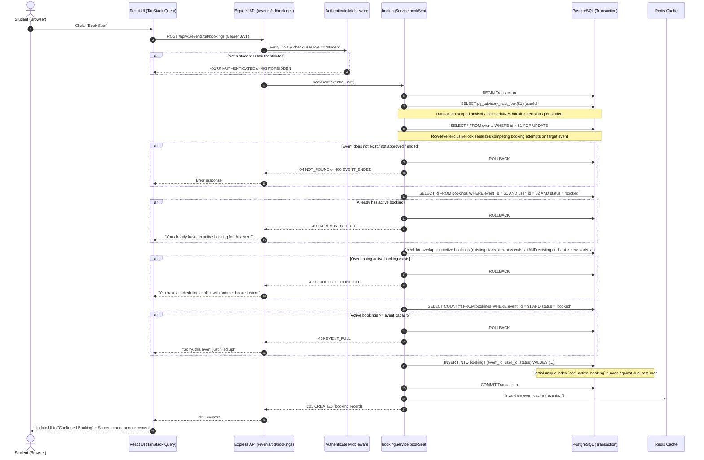

# CampusPass — Booking & Cancellation Flow

This document specifies the end-to-end booking and cancellation lifecycle in CampusPass, detailing transaction semantics, concurrency isolation, schedule conflict detection, and failure handling.

---

## 1. Sequence Diagram: Booking Flow



---

## 2. Concurrency Guarantees & Lock Hierarchy

1. **Student Serialization (`SELECT pg_advisory_xact_lock(user_id)`):**
   - Locking only the event row is insufficient when a single student submits concurrent booking requests for two *different* events whose schedules overlap.
   - To serialize booking decisions per student without deadlocking, CampusPass acquires a PostgreSQL transaction-scoped advisory lock using the 64-bit hashed integer of `user_id` at the start of the transaction before locking event rows.
   - Advisory transaction locks automatically release on `COMMIT` or `ROLLBACK`.

2. **Row-Level Event Serialization (`SELECT ... FOR UPDATE`):**
   - When multiple students compete simultaneously for the last remaining seat of an event, PostgreSQL queues competing transactions on the target event row.
   - Each transaction sequentially reads the committed active booking count, ensuring event capacity is strictly respected.

3. **Consistent Global Lock Hierarchy:**
   - Always acquire `pg_advisory_xact_lock(user_id)` first, followed by `SELECT ... FOR UPDATE` on `events`.
   - By acquiring locks in this identical order across all booking endpoints, deadlocks are mathematically eliminated.

4. **Double Protection via Partial Unique Index:**
   - `CREATE UNIQUE INDEX one_active_booking ON bookings(event_id, user_id) WHERE status = 'booked';`
   - Enforces database-level uniqueness for active bookings per event-user pair.

5. **No Redis Dependency for Correctness:**
   - Redis is used strictly as an ephemeral read cache and rate-limiter.
   - All booking authority, conflict validation, and capacity calculations reside strictly within PostgreSQL ACID transactions.

---

## 3. Schedule Conflict Business Rule

A student cannot have active bookings for two events whose scheduled time intervals overlap.

### Overlap Condition
Two time intervals `[existing.starts_at, existing.ends_at)` and `[new.starts_at, new.ends_at)` overlap if and only if:
```sql
existing.starts_at < new.ends_at AND existing.ends_at > new.starts_at
```

### Boundary & Cancellation Rules:
- **Adjacent Events Allowed:** Events meeting exactly at an endpoint (e.g. 10:00–12:00 and 12:00–1:00) do **not** overlap because strict inequalities (`<` and `>`) evaluate to `false` at equal boundary timestamps.
- **Cancelled Bookings Excluded:** Any booking with `status = 'cancelled'` is excluded from the overlap query (`status = 'booked'`). A student whose previous conflicting booking was cancelled is free to book the new event.

---

## 4. Cancellation Flow & 2-Hour Cutoff

- **Endpoint:** `DELETE /api/v1/bookings/:id`
- **Ownership Check:** Verified on server that `booking.user_id === req.user.id`.
- **Timing Constraint:** `starts_at - now >= 2 hours (7,200,000 ms)`.
  - If `< 2 hours`: Rejection with `409 Conflict` and error code `CANCEL_WINDOW_CLOSED`.
- **Preservation:** The record is updated to `status = 'cancelled'` and `cancelled_at = now()`. The slot becomes available for other students, and the cancelled user is no longer constrained by schedule conflicts for that time block.

---

## 5. Documented Error Codes

| Error Code | HTTP Status | Meaning |
| :--- | :--- | :--- |
| `UNAUTHENTICATED` | 401 | Missing or invalid access token |
| `FORBIDDEN` | 403 | Role permissions insufficient (e.g. non-student booking, non-owner cancelling) |
| `NOT_FOUND` | 404 | Event or booking record does not exist |
| `ALREADY_BOOKED` | 409 | Student already has an active confirmed booking for this event |
| `SCHEDULE_CONFLICT` | 409 | Student has an active booking that overlaps the target event's time interval |
| `EVENT_FULL` | 409 | Event capacity has been exhausted |
| `CANCEL_WINDOW_CLOSED` | 409 | Cancellation attempted less than 2 hours before start time |
| `VALIDATION_ERROR` | 422 | Payload fails Zod validation criteria |
| `RATE_LIMITED` | 429 | Exceeded Redis rate-limit window |
